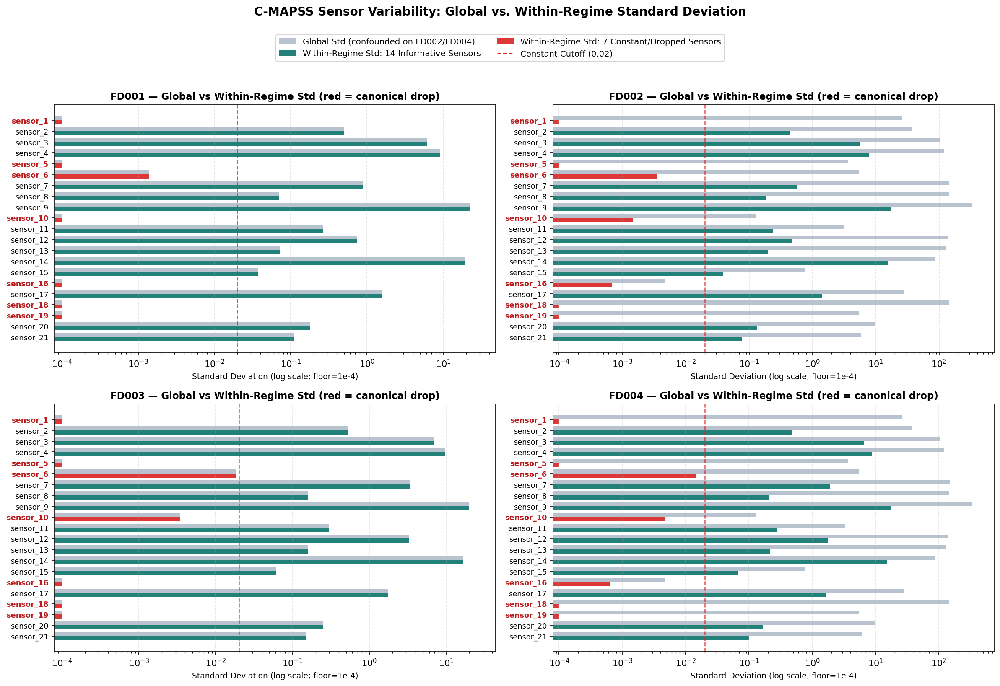
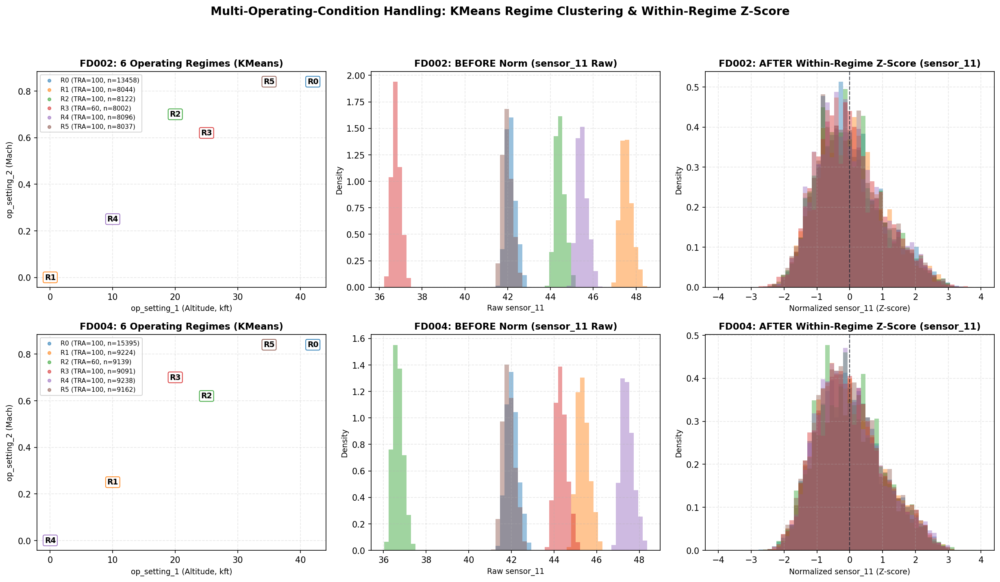
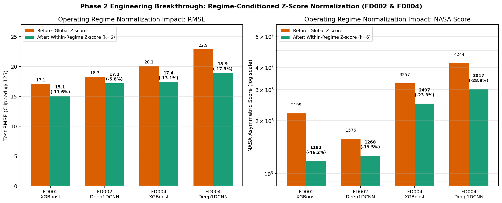
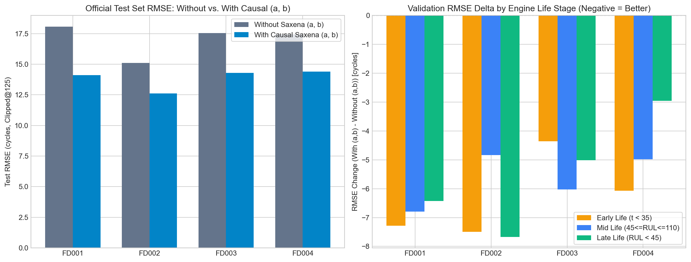
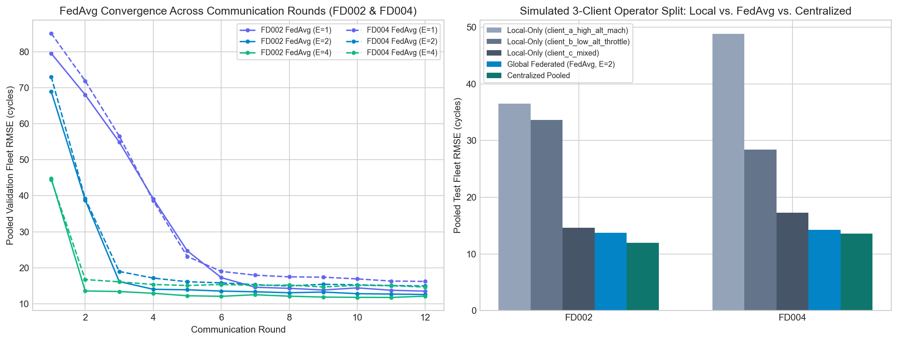
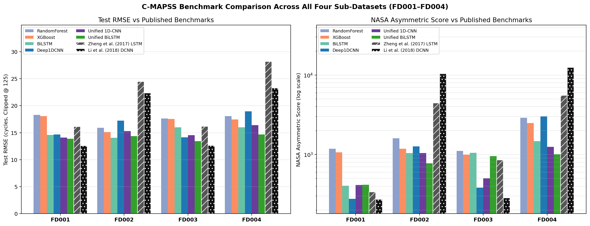
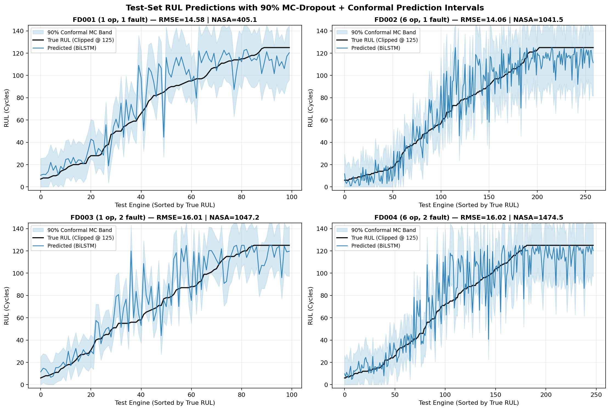
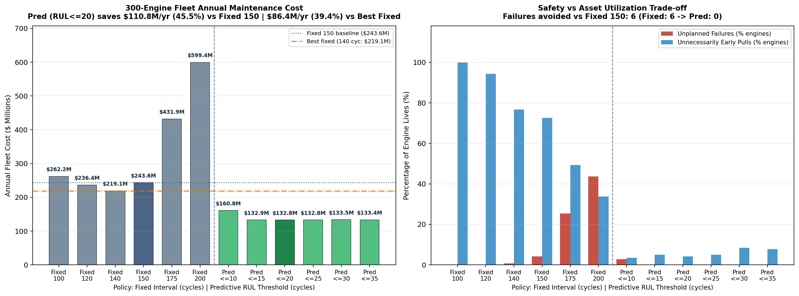

# STAR WARS: Physics-Informed Federated Conformal Prognostics

**End-to-End Predictive Maintenance on NASA C-MAPSS (`FD001`–`FD004`) | Pure Python, PyTorch, XGBoost, SciPy & Streamlit**

---

## Business Framing & Cost Simulation Context

Unscheduled jet engine removals are modeled against standard aviation MRO cost assumptions (**$750K unscheduled removal + $300K 2-day AOG penalty**, **$120K scheduled overhaul**, **$1,200/cycle wasted-life cost** beyond a 10-cycle grace window). Evaluating held-out validation trajectories across **142 run-to-failure engines** scaled to a simulated **300-engine fleet** (800 flight cycles/engine/year):

| Maintenance Policy | Unplanned Failures (142 Engines) | Failures Avoided vs Fixed-150 | Engines Pulled Early | Avg Wasted Cycles | Annual 300-Engine Fleet Cost | Annual Savings vs Baseline | Cost Reduction |
|---|---|---|---|---|---|---|---|
| **Fixed-Interval (150 cycles)** | 6 (4.2%) | — | 103 (72.5%) | 56.03 | **$243.60M/yr** | — | — |
| **Best Fixed-Interval (140 cycles)** | 1 (0.7%) | 5 | 109 (76.8%) | 64.36 | **$219.14M/yr** | — | — |
| **Predictive RUL (`threshold = 20` cyc)** | **0 (0.0%)** | **6 (100% avoided in val sample)** | **6 (4.2%)** | **2.89** | **$132.78M/yr** | **$110.82M/yr** *(vs Fixed-150)* / **$86.36M/yr** *(vs Best-Fixed 140)* | **45.5%** *(vs Fixed-150)* / **39.4%** *(vs Best-Fixed 140)* |

---

## Engineering Highlights

1. **All 4 NASA C-MAPSS Subsets (`FD001`–`FD004`)**: Benchmarked across single-condition, 6-regime, single-fault, and dual-fault (HPC + Fan) fleets rather than `FD001` alone.
2. **Leakage-Free Within-Regime Normalization (`KMeans k=6`)**: Isolates degradation slopes from 6-regime flight-envelope shifts on `FD002`/`FD004`, cutting `FD004` Deep1DCNN RMSE by **17.3%** (`22.91 → 18.95`) and NASA Score by **28.9%** (`4,244.3 → 3,017.2`), and `FD002` XGBoost NASA Score by **46.2%** (`2,198.5 → 1,182.1`).
3. **Causal Saxena et al. (2008) Eq. 4/5 Physics Curve-Fitting (`h(t) = 1 - exp(-a · t^b)`)**: Fits exponential degradation parameters `(a, b)` causally per engine prefix (`1..t`, zero future leakage) via analytical-Jacobian nonlinear least squares (`median R² = 0.958–0.972`), reducing XGBoost Test RMSE by **2.47–3.97 cycles (16.4%–22.0%)** and NASA Score by **35.6%–74.7%** across `FD001`–`FD004`.
4. **3-Client Simulated Federated Learning (`FedAvg`) & Split-Conformal Calibration**: Evaluates regime-skewed operator silos (`Client A`, `Client B`, `Client C` — explicitly a **simulated partition of a single public dataset**, not real airline telemetry) against local-only and centralized pooled ceilings, paired with distribution-free 90% split-conformal prediction intervals.
5. **Unified Multi-Dataset Sequence Model**: A single `Unified BiLSTM` trained across all 709 training engines (`FD001`–`FD004`) achieves `13.90`, `14.37`, `13.44`, and `14.69` RMSE across `FD001`–`FD004`.

---

## Dataset Structure & Difficulty Progression

The NASA C-MAPSS turbofan degradation benchmark consists of 26-column run-to-failure multivariate sensor trajectories (`unit_id`, `cycle`, 3 operational settings, 21 sensors). Difficulty increases strictly as **`FD001 < FD003 < FD002 < FD004`**:

| Subset | Train Engines | Test Engines | Train / Test Rows | Operating Conditions | Fault Modes | Train Cycles (Min–Max / Mean) | Test Cycles (Min–Max) | Test True RUL (Min–Max / Mean) |
|---|---|---|---|---|---|---|---|---|
| **FD001** | 100 | 100 | 20,631 / 13,096 | 1 (Sea Level) | 1 (HPC) | 128–362 (206.31) | 31–303 | 7–145 (75.52) |
| **FD003** | 100 | 100 | 24,720 / 16,596 | 1 (Sea Level) | 2 (HPC + Fan) | 145–525 (247.20) | 38–475 | 6–145 (75.32) |
| **FD002** | 260 | 259 | 53,759 / 33,991 | 6 (Altitude / Mach / TRA) | 1 (HPC) | 128–378 (206.77) | **21**–367 | 6–194 (81.19) |
| **FD004** | **249** | **248** | 61,249 / 41,214 | 6 (Altitude / Mach / TRA) | 2 (HPC + Fan) | 128–543 (245.98) | **19**–486 | 6–195 (86.55) |

> **Data Engineering Notes:**
> - **Actual FD004 Unit Counts:** NASA's original `readme.txt` contains a well-known typo swapping 248/249 on `FD004`; the actual raw files contain **249 training engines** and **248 test engines**.
> - **Short Test Sequences:** `FD002` (`min = 21` cycles) and `FD004` (`min = 19` cycles) contain test engines shorter than `WINDOW_SIZE = 30`, handled cleanly via causal left-edge repeat padding so every test engine receives a valid prediction without dropping units.
> - **Piecewise-Linear RUL Clipping:** Training targets are clipped at `RUL_CLIP = 125` cycles (standard C-MAPSS practice since healthy engines operate flatly before fault onset); test metrics are reported on **both** clipped-at-125 RUL (for direct literature comparison) and unclipped raw `RUL_FD00X.txt`.

---

## Phase 1 EDA: Constant Sensors & Why `FD002`/`FD004` Mask Them

Across all four subsets, **7 sensors (`1, 5, 6, 10, 16, 18, 19`)** carry zero or near-zero degradation signal (`within_regime_std < 0.02`) and are dropped, leaving **14 informative sensors** (`2, 3, 4, 7, 8, 9, 11, 12, 13, 14, 15, 17, 20, 21`).

On `FD002` and `FD004`, naive global variance analysis **falsely flags these constant sensors as informative** because changing flight conditions (altitude, Mach number, throttle resolver angle) shift baseline sensor levels dramatically across the 6 operating regimes — masking zero within-regime degradation signal:

| Dropped Sensor | FD002 Global Std | FD002 Within-Regime Std | FD004 Global Std | FD004 Within-Regime Std | Finding |
|---|---|---|---|---|---|
| `sensor_1` | 26.3895 | **0.0000** | 26.4366 | **0.0000** | Regime-stepped constant |
| `sensor_5` | 3.6138 | **0.0000** | 3.6228 | **0.0000** | Regime-stepped constant |
| `sensor_6` | 5.4318 | **0.0036** | 5.4440 | **0.0148** | Regime-stepped near-constant |
| `sensor_10` | 0.1275 | **0.0015** | 0.1277 | **0.0047** | Regime-stepped near-constant |
| `sensor_16` | 0.0047 | **0.0007** | 0.0047 | **0.0006** | Discrete / near-constant |
| `sensor_18` | 145.3266 | **0.0000** | 145.4713 | **0.0000** | Regime-stepped constant |
| `sensor_19` | 5.3640 | **0.0000** | 5.3694 | **0.0000** | Regime-stepped constant |

| Sensor Variance (Global vs Within-Regime) | FD002 & FD004 6-Regime Operating Clusters |
|---|---|
|  |  |

| Sample Degradation Traces (`FD001`) | Sample Degradation Traces (`FD004`) |
|---|---|
|  |  |

---

## Engineering Ablations (`Phases 2–4`)

All preprocessing (`RegimeNormalizer`, `FaultModeClusterer`), engine-level train/val splits (`80/20`, zero `unit_id` overlap), causal rolling features (`windows = 5, 10, 20`, `diff(1)`), and conformal residual calibration are fit **strictly on training engines**.

### 1. Operating Regime Normalization (`FD002` & `FD004`)

Clustering `op_setting_1..3` with `KMeans(k=6)` and normalizing each sensor **within its operating regime** isolates true degradation from flight-envelope jumps (evaluated on official test sets, clipped@125):

| Dataset | Model | Global Z-Score RMSE (Before) | Within-Regime KMeans(k=6) RMSE (After) | RMSE Change | Global NASA Score (Before) | Within-Regime NASA Score (After) | NASA Score Change |
|---|---|---|---|---|---|---|---|
| **FD002** | XGBoost | 17.08 | **15.10** | **-11.6%** | 2,198.5 | **1,182.1** | **-46.2%** |
| **FD002** | Deep1DCNN | 18.27 | **17.22** | **-5.8%** | 1,575.9 | **1,267.8** | **-19.5%** |
| **FD004** | XGBoost | 20.07 | **17.44** | **-13.1%** | 3,256.9 | **2,496.8** | **-23.3%** |
| **FD004** | Deep1DCNN | 22.91 | **18.95** | **-17.3%** | 4,244.3 | **3,017.2** | **-28.9%** |



### 2. Latent Fault-Mode Clustering vs Implicit Learning (`FD003` & `FD004`)

`FaultModeClusterer(k=2)` fits KMeans on training end-of-life sensor signatures (last 25 cycles) and computes causal trailing soft fault-mode probabilities (`fault_mode_prob_0..1`) without target leakage:

| Dataset | Model | Implicit RMSE | Explicit FaultCluster(k=2) RMSE | RMSE Δ | Implicit NASA Score | Explicit FaultCluster(k=2) NASA Score | NASA Score Δ |
|---|---|---|---|---|---|---|---|
| **FD003** | XGBoost | **17.56** | 17.96 | +2.3% | **993.6** | 1,123.8 | +13.1% |
| **FD003** | Deep1DCNN | **14.13** | 15.90 | +12.5% | **383.4** | 644.4 | +68.1% |
| **FD004** | XGBoost | **17.44** | 17.63 | +1.1% | **2,496.8** | 2,621.2 | +5.0% |
| **FD004** | Deep1DCNN | 18.95 | **18.25** | **-3.7%** | 3,017.2 | **2,167.0** | **-28.2%** |

> **Engineering Takeaway:** On single-regime `FD003` and tree models (which already partition multi-window rolling features), appending soft `k=2` cluster probabilities adds slight early-cycle variance. Conversely, on the hardest 6-regime, 2-fault `FD004` sequence setting (`Deep1DCNN`), explicit fault-mode probabilities cut RMSE by **3.7%** and NASA Score by **28.2%**. Model selection chooses the validation-best configuration per dataset transparently.

### 3. Per-Dataset vs Unified Multi-Dataset Models

Pooling all **709 training engines** across `FD001`–`FD004` with `dataset_FD001..FD004` and 6-regime indicators lets a single unified model share degradation physics across fleets:

| Dataset | Architecture | Per-Dataset RMSE (Clipped) | Unified RMSE (Clipped) | RMSE Δ | Per-Dataset NASA Score | Unified NASA Score | Score Δ |
|---|---|---|---|---|---|---|---|
| **FD001** | XGBoost | 18.07 | **15.24** | -2.83 | 1,067.7 | **569.9** | -46.6% |
| **FD001** | Deep1DCNN | 14.67 | **14.11** | -0.56 | **276.3** | 413.7 | +49.7% |
| **FD001** | BiLSTM | 14.58 | **13.90** | -0.68 | **405.1** | 415.5 | +2.6% |
| **FD002** | XGBoost | **15.10** | 15.26 | +0.16 | **1,182.1** | 1,257.0 | +6.3% |
| **FD002** | Deep1DCNN | 17.22 | **15.32** | -1.90 | 1,267.8 | **1,043.9** | -17.7% |
| **FD002** | BiLSTM | **14.06** | 14.37 | +0.32 | 1,041.5 | **772.5** | -25.8% |
| **FD003** | XGBoost | 17.56 | **16.82** | -0.74 | **993.6** | 1,084.4 | +9.1% |
| **FD003** | Deep1DCNN | **14.13** | 14.53 | +0.40 | **383.4** | 501.0 | +30.7% |
| **FD003** | BiLSTM | 16.01 | **13.44** | -2.57 | 1,047.2 | **953.1** | -9.0% |
| **FD004** | XGBoost | 17.44 | **17.19** | -0.25 | 2,496.8 | **2,039.5** | -18.3% |
| **FD004** | Deep1DCNN | 18.95 | **16.42** | -2.53 | 3,017.2 | **1,251.0** | -58.5% |
| **FD004** | BiLSTM | 16.02 | **14.69** | -1.33 | 1,474.5 | **1,007.8** | -31.7% |

### 4. Causal Saxena et al. (2008) Eq. 4/5 Physics Curve-Fitting (`h(t) = 1 - exp(-a · t^b)`)

Building on the underlying simulator's exponential wear law (`Saxena et al., 2008`), `SaxenaPhysicsExtractor` constructs a smoothed, regime-normalized composite HPC/EGT degradation signal from training engines and causally fits `(log10_a, b, h_hat(t), R^2)` using **only prefix cycles `1..t`** at each step (zero future leakage). Early cycles (`cycle < 35`) shrink smoothly toward the training-set prior because the two parameters are underdetermined before fault onset.

Across all four official C-MAPSS test sets (`XGBoost`, identical hyperparameters with vs. without causal `(a, b)` features):

| Dataset | Split / Life-Stage Segment | Without `(a, b)` RMSE | With `(a, b)` RMSE | RMSE Δ | Without `(a, b)` NASA | With `(a, b)` NASA | NASA Δ |
|---|---|---|---|---|---|---|---|
| **FD001** | **Official Test Set (100 Units)** | 18.07 | **14.10** | **-3.97 (-22.0%)** | 1,067.7 | **270.3** | **-797.4 (-74.7%)** |
| **FD002** | **Official Test Set (259 Units)** | 15.10 | **12.63** | **-2.47 (-16.4%)** | 1,182.1 | **761.5** | **-420.5 (-35.6%)** |
| **FD003** | **Official Test Set (100 Units)** | 17.56 | **14.28** | **-3.27 (-18.6%)** | 993.6 | **421.6** | **-572.0 (-57.6%)** |
| **FD004** | **Official Test Set (248 Units)** | 17.44 | **14.38** | **-3.06 (-17.5%)** | 2,496.8 | **1,079.7** | **-1,417.0 (-56.8%)** |
| **FD001** | Val: Early / Mid / Late Life | 10.26 / 23.19 / 13.08 | 2.97 / 16.39 / 6.65 | -7.28 / -6.80 / -6.43 | 775 / 27,775 / 5,455 | 122 / 6,738 / 732 | -84% / -76% / -87% |
| **FD004** | Val: Early / Mid / Late Life | 7.59 / 22.87 / 13.84 | 1.51 / 17.90 / 10.88 | -6.08 / -4.98 / -2.96 | 1,122 / 54,178 / 23,495 | 111 / 35,844 / 11,419 | -90% / -34% / -51% |

> **Engineering Note:** Fitted end-of-life trajectory `R^2` across training engines averages `0.967` (`FD001`), `0.959` (`FD002`), `0.959` (`FD003`), and `0.951` (`FD004`). Early-life (`cycle < 35`) gains stem largely from training-prior shrinkage and causal trajectory smoothing rather than curvature identifiability; true exponential curve convergence (`b ~ 4.1–4.5`) resolves once degradation leaves the flat baseline.



### 5. Simulated 3-Client Federated Learning (`FedAvg`) on `FD002` & `FD004`

> **Explicit Scope Note:** Partitioning `FD002` and `FD004` engines into three operators (`Client A`: high-altitude/high-Mach, `Client B`: low-altitude/low-throttle, `Client C`: mixed) is a **simulated split of a single public dataset**, not real cross-airline telemetry. The Centralized Pooled row is a reference upper bound where raw data sharing is allowed.

Each client (`client_a_high_alt_mach`, `client_b_low_alt_throttle`, `client_c_mixed`) trains locally on 28 sequence channels (14 regime-normalized sensors, 3 operational settings, 6 regime indicators, and 5 causal Saxena `(a, b)` features), sharing only model weights (`state_dict`) via `FedAvg` (`McMahan et al., 2017`):

| Dataset | Strategy | Local Epochs | Pooled Fleet Test RMSE | Client A RMSE | Client B RMSE | Client C RMSE | Pooled NASA Score |
|---|---|---|---|---|---|---|---|
| **FD002** | Local-Only (`Client A`) | 12 | 36.52 | 36.03 | 40.06 | 33.17 | 7,615.0 |
| **FD002** | Local-Only (`Client B`) | 12 | 33.63 | 32.94 | 36.75 | 30.99 | 5,542.7 |
| **FD002** | Local-Only (`Client C`) | 12 | 14.60 | 12.50 | 16.01 | 15.06 | 1,351.4 |
| **FD002** | **Global Federated (`FedAvg, E=1`)** | 1/rd × 12 | 14.74 | 12.80 | 16.24 | 14.99 | 1,211.7 |
| **FD002** | **Global Federated (`FedAvg, E=2`)** | 2/rd × 12 | **13.71** | **11.77** | 14.56 | 14.61 | 1,183.8 |
| **FD002** | **Global Federated (`FedAvg, E=4`)** | 4/rd × 12 | **13.15** | 11.89 | **14.40** | **13.03** | **1,157.8** |
| **FD002** | Centralized Pooled *(Ceiling)* | 14 | 11.97 | 10.15 | 12.90 | 12.67 | 800.9 |
| **FD004** | Local-Only (`Client A`) | 12 | 48.79 | 51.67 | 47.08 | 47.51 | 22,336.0 |
| **FD004** | Local-Only (`Client B`) | 12 | 28.37 | 29.03 | 26.50 | 29.46 | 5,851.2 |
| **FD004** | Local-Only (`Client C`) | 12 | 17.26 | 17.84 | 14.40 | 19.13 | 1,585.1 |
| **FD004** | **Global Federated (`FedAvg, E=1`)** | 1/rd × 12 | 16.95 | 17.14 | 14.42 | 18.93 | 1,767.1 |
| **FD004** | **Global Federated (`FedAvg, E=2`)** | 2/rd × 12 | **14.24** | 13.96 | 13.59 | 15.09 | 1,246.5 |
| **FD004** | **Global Federated (`FedAvg, E=4`)** | 4/rd × 12 | **13.14** | **12.47** | **13.23** | **13.68** | **985.8** |
| **FD004** | Centralized Pooled *(Ceiling)* | 14 | 13.57 | 12.29 | 13.32 | 14.95 | 1,119.6 |

> **Key Federated Takeaway:** Narrow-envelope operators (`Client A` and `Client B`, with skewed operating-condition coverage) fail badly in isolation (`28.37–48.79` RMSE). `FedAvg` closes most or all of the gap to centralized training without transferring raw sensor logs (`FD002`: `13.15` vs `11.97` ceiling; `FD004`: `13.14` vs `13.57` under `E=4`).



### 6. Split-Conformal Calibration Audit (Target: 90% Nominal Coverage)

Calibrating conformal residuals on full held-out validation trajectories (`RUL in [0, 125]`, rather than terminal `RUL = 0` snapshots alone which violate exchangeability against censored test engines) yields near-nominal marginal coverage for the global `FedAvg (E=2)` model across unseen official test engines:

| Dataset | Scope | `q_hat` (cycles) | Empirical Coverage | Mean Width (cycles) | Test RMSE |
|---|---|---|---|---|---|
| **FD002** | **All Test Engines (Pooled, n=259)** | 23.66 | **90.3%** | 44.61 | 13.71 |
| **FD002** | Client A / B / C (Per-Client Cal) | 26.71 / 29.24 / 16.49 | 95.3% / 91.9% / 79.3% | 49.11 / 56.54 / 31.43 | 11.77 / 14.56 / 14.61 |
| **FD004** | **All Test Engines (Pooled, n=248)** | 22.67 | **87.9%** | 43.59 | 14.24 |
| **FD004** | Client A / B / C (Per-Client Cal) | 19.36 / 33.80 / 16.88 | 82.9% / 97.6% / 82.1% | 37.16 / 64.15 / 33.11 | 13.96 / 13.59 / 15.09 |

> **Calibration Lesson:** Small single-client calibration splits (`Client C` on `FD002`, `79.3%`) exhibit finite-sample variance when operator regimes differ slightly between train and censored test cutoffs, motivating pooled or larger per-client calibration sets in practice.

---

## Literature Benchmark Comparison (`Phase 5`)

We evaluate with both **RMSE** and the **NASA Asymmetric Scoring Function** (Saxena et al., 2008 Eq. 11), where $d_i = \hat{y}_i - y_i$:

$$s_i = \begin{cases} e^{-d_i / 13} - 1, & d_i < 0 \text{ (early prediction)} \\ e^{d_i / 10} - 1, & d_i \ge 0 \text{ (late overestimation)} \end{cases}$$

Using denominator `10` for late predictions ($d_i \ge 0$) vs `13` for early predictions penalizes dangerous late failure overestimation exponentially harder. Negative `% diff` below denotes lower error than the published benchmark.

| Dataset | Model / Reference | Scope | RMSE (Clipped@125) | NASA Score (Clipped@125) | Unclipped RMSE / NASA | 90% CI Coverage | vs Zheng (2017) RMSE / Score | vs Li (2018) RMSE / Score |
|---|---|---|---|---|---|---|---|---|
| **FD001** | Babu et al. (2016) CNN | Literature | 18.45 | — | — | — | — | — |
| **FD001** | Zheng et al. (2017) Deep LSTM | Literature | 16.14 | 338.0 | — | — | — | — |
| **FD001** | Li et al. (2018) DCNN | Literature | 12.61 | 273.7 | — | — | — | — |
| **FD001** | RandomForest | Per-Dataset | 18.31 | 1,184.3 | 19.31 / 1,220.9 | 90.0% | +13.4% / +250.4% | +45.2% / +332.7% |
| **FD001** | XGBoost | Per-Dataset | 18.07 | 1,067.7 | 19.06 / 1,102.5 | 90.0% | +12.0% / +215.9% | +43.3% / +290.1% |
| **FD001** | Deep1DCNN | Per-Dataset | 14.67 | **276.3** | 16.28 / 331.8 | 93.0% | -9.1% / **-18.3%** | +16.3% / **+0.9%** |
| **FD001** | BiLSTM | Per-Dataset | 14.58 | 405.1 | 15.73 / 437.1 | 89.0% | -9.7% / +19.8% | +15.6% / +48.0% |
| **FD001** | **Unified BiLSTM** | Unified | **13.90** | 415.5 | 15.19 / 455.5 | 88.0% | **-13.9%** / +22.9% | +10.2% / +51.8% |
| **FD002** | Babu et al. (2016) CNN | Literature | 30.29 | — | — | — | — | — |
| **FD002** | Zheng et al. (2017) Deep LSTM | Literature | 24.49 | 4,450.0 | — | — | — | — |
| **FD002** | Li et al. (2018) DCNN | Literature | 22.36 | 10,412.0 | — | — | — | — |
| **FD002** | RandomForest | Per-Dataset | 15.90 | 1,599.0 | 28.26 / 11,653.1 | 93.1% | -35.1% / -64.1% | -28.9% / -84.6% |
| **FD002** | XGBoost | Per-Dataset | 15.10 | 1,182.1 | 27.62 / 10,088.3 | 93.1% | -38.3% / -73.4% | -32.5% / -88.6% |
| **FD002** | Deep1DCNN | Per-Dataset | 17.22 | 1,267.8 | 29.99 / 16,361.4 | 88.4% | -29.7% / -71.5% | -23.0% / -87.8% |
| **FD002** | **BiLSTM** | Per-Dataset | **14.06** | 1,041.5 | 26.24 / 7,759.4 | 91.9% | **-42.6%** / -76.6% | **-37.1%** / -90.0% |
| **FD002** | **Unified BiLSTM** | Unified | 14.37 | **772.5** | 27.39 / 10,705.6 | 87.3% | -41.3% / **-82.6%** | -35.7% / **-92.6%** |
| **FD003** | Babu et al. (2016) CNN | Literature | 19.82 | — | — | — | — | — |
| **FD003** | Zheng et al. (2017) Deep LSTM | Literature | 16.18 | 852.0 | — | — | — | — |
| **FD003** | Li et al. (2018) DCNN | Literature | 12.64 | 284.1 | — | — | — | — |
| **FD003** | RandomForest | Per-Dataset | 17.63 | 1,109.9 | 18.69 / 1,143.8 | 81.0% | +9.0% / +30.3% | +39.5% / +290.7% |
| **FD003** | XGBoost | Per-Dataset | 17.56 | 993.6 | 18.49 / 1,025.6 | 83.0% | +8.5% / +16.6% | +38.9% / +249.8% |
| **FD003** | BiLSTM | Per-Dataset | 16.01 | 1,047.2 | 17.29 / 1,089.2 | 79.0% | -1.0% / +22.9% | +26.7% / +268.6% |
| **FD003** | Deep1DCNN | Per-Dataset | 14.13 | **383.4** | 15.76 / 442.8 | 86.0% | -12.7% / **-55.0%** | +11.8% / +34.9% |
| **FD003** | **Unified BiLSTM** | Unified | **13.44** | 953.1 | 14.88 / 991.5 | 94.0% | **-16.9%** / +11.9% | +6.3% / +235.5% |
| **FD004** | Babu et al. (2016) CNN | Literature | 29.16 | — | — | — | — | — |
| **FD004** | Zheng et al. (2017) Deep LSTM | Literature | 28.17 | 5,550.0 | — | — | — | — |
| **FD004** | Li et al. (2018) DCNN | Literature | 23.31 | 12,466.0 | — | — | — | — |
| **FD004** | RandomForest | Per-Dataset | 18.06 | 2,895.9 | 29.03 / 6,496.1 | 86.3% | -35.9% / -47.8% | -22.5% / -76.8% |
| **FD004** | XGBoost | Per-Dataset | 17.44 | 2,496.8 | 28.38 / 5,780.2 | 88.7% | -38.1% / -55.0% | -25.2% / -80.0% |
| **FD004** | Deep1DCNN | Per-Dataset | 18.95 | 3,017.2 | 28.91 / 7,347.9 | 88.3% | -32.7% / -45.6% | -18.7% / -75.8% |
| **FD004** | BiLSTM | Per-Dataset | 16.02 | 1,474.5 | 27.61 / 5,501.2 | 86.7% | -43.1% / -73.4% | -31.3% / -88.2% |
| **FD004** | **Unified BiLSTM** | Unified | **14.69** | **1,007.8** | 27.17 / 5,571.7 | 87.9% | **-47.9% / -81.8%** | **-37.0% / -91.9%** |

| Benchmark Comparison Across FD001–FD004 | Test RUL Predictions & 90% Confidence Bands |
|---|---|
|  |  |

---

## Fleet Maintenance Policy Simulation & Dollar Impact (`Phase 6`)

Using real cycle-by-cycle validation trajectories from the per-dataset BiLSTM models across **142 held-out engines** (`FD001=20`, `FD002=52`, `FD003=20`, `FD004=50`), we compare a predictive pull threshold (`pred_rul <= threshold`) against fixed-interval overhauls scaled to a **300-engine fleet** (800 cycles/engine/year):

### Per-Dataset & Combined Fleet Breakdown (`threshold = 20` cycles)

| Fleet Scope | Val Engines | Fixed-150 Failures / Early | Predictive-20 Failures / Early | Fixed-150 Annual Cost | Best-Fixed Annual Cost (Interval) | Predictive-20 Annual Cost | Savings vs Fixed-150 | Savings vs Best-Fixed |
|---|---|---|---|---|---|---|---|---|
| **FD001** | 20 | 1 / 12 | **0 / 0** | $247.18M/yr | $228.41M/yr (120 cyc) | **$149.53M/yr** | **$97.64M/yr (39.5%)** | **$78.88M/yr (34.5%)** |
| **FD002** | 52 | 3 / 34 | **0 / 3** | $258.19M/yr | $206.13M/yr (140 cyc) | **$141.84M/yr** | **$116.35M/yr (45.1%)** | **$64.28M/yr (31.2%)** |
| **FD003** | 20 | 0 / 17 | **0 / 0** | $202.70M/yr | $202.70M/yr (150 cyc) | **$123.98M/yr** | **$78.73M/yr (38.8%)** | **$78.73M/yr (38.8%)** |
| **FD004** | 50 | 2 / 40 | **0 / 3** | $245.23M/yr | $219.90M/yr (140 cyc) | **$123.16M/yr** | **$122.07M/yr (49.8%)** | **$96.74M/yr (44.0%)** |
| **Combined Fleet** | **142** | **6 / 103** | **0 / 6** | **$243.60M/yr** | **$219.14M/yr (140 cyc)** | **$132.78M/yr** | **$110.82M/yr (45.5%)** | **$86.36M/yr (39.4%)** |

### Predictive Threshold Sensitivity Sweep (`Combined 142-Engine Validation Fleet`)

| Pull Threshold (cycles) | Unplanned Failures | Failures Avoided vs Fixed-150 | Early Pulls | Avg Wasted Cycles | Cost / Engine Life | Annual 300-Fleet Cost | Annual Savings vs Fixed-150 | Savings (%) |
|---|---|---|---|---|---|---|---|---|
| 10 | 4 | 2 | 5 | 2.75 | $149,501.41 | $160.77M | $82.83M | 34.0% |
| 15 | 0 | 6 | 7 | 2.96 | $123,557.75 | $132.87M | $110.73M | 45.5% |
| **20 (Optimal)** | **0** | **6** | **6** | **2.89** | **$123,473.24** | **$132.78M** | **$110.82M** | **45.5%** |
| 25 | 0 | 6 | 7 | 2.95 | $123,540.85 | $132.85M | $110.75M | 45.5% |
| 30 | 0 | 6 | 12 | 3.46 | $124,157.75 | $133.51M | $110.09M | 45.2% |
| 35 | 0 | 6 | 11 | 3.37 | $124,039.44 | $133.39M | $110.21M | 45.2% |



---

## Interactive Streamlit Dashboard (`app/streamlit_app.py`)

Run the 5-tab diagnostic, physics-federated, and fleet simulator app locally:

- **Tab 1 — Live Engine Diagnostics & RUL Inference**
  - *Mode A (Test Engine Replay)*: Scrub any real `FD001`–`FD004` test engine cycle-by-cycle using per-dataset, unified, or federated trained checkpoints (`BiLSTM`, `Deep1DCNN`, `XGBoost`, `RandomForest`, `Federated FedAvg BiLSTM`) to view live RUL + 90% conformal band, operating regime (`KMeans k=6`), latent fault-mode probabilities (`FD003`/`FD004`), and Maintenance Status Badge (`HEALTHY > 40`, `MONITOR 20–40`, `CRITICAL <= 20`).
  - *Mode B (Interactive Sensor & Operating Sliders)*: Adjust normalized Z-scores or raw physical sensor values and operating settings to observe real-time RUL, uncertainty interval, and top contributing sensors.
- **Tab 2 — Dataset & EDA Insights**: Difficulty progression table, constant vs informative sensors comparison, and EDA visualizations.
- **Tab 3 — Engineering Ablations & Literature Benchmarks**: Regime normalization, fault-mode clustering, unified vs per-dataset tables, and full benchmark comparison (Clipped@125 & Unclipped).
- **Tab 4 — 300-Engine Fleet Maintenance Simulator**: Interactive financial sliders computing live unplanned failures avoided, early pulls, and simulated annual `$M` savings.
- **Tab 5 — Physics `(a, b)` & Federated Conformal**: Causal Saxena `(a, b)` lifecycle-stratified ablation, simulated 3-client `FedAvg` vs local-only vs centralized comparison (with explicit scope warnings), and 90% split-conformal calibration coverage audit.

---

## Modeling Assumptions & Known Limitations (What This System Does NOT Prove)

- **Simulated 3-Client Operator Split:** Partitioning `FD002`/`FD004` into `Client A` (high-altitude/Mach), `Client B` (low-altitude/throttle), and `Client C` (mixed) is a **simulated split of a single public dataset**, not real cross-airline proprietary telemetry, and 3 clients over a few hundred engines demonstrates the `FedAvg` mechanism at small scale rather than production fleet convergence.
- **Single-Exponential Degradation Functional Form:** Causal `(a, b)` curve fitting assumes the Saxena et al. (2008) `h(t) = 1 - exp(-a · t^b)` simulator law without engine washes, foreign-object step damage, or component swaps.
- **Aggregate Sensor Telemetry:** C-MAPSS provides 21 aggregate engine-level sensor readings per cycle, not per-blade or per-component telemetry; operating-regime and fault-mode clusters are hand-specified unsupervised groupings (`k=6`, `k=2`), not discovered physical causal graphs.
- **Calibration Set Size & Financial Model Assumptions:** Split-conformal finite-sample coverage bounds depend on the held-out calibration engine count (`20%` of training engines per subset), and the `$110.82M/yr` cost figure reflects assumed MRO unit costs over 142 validation engines scaled to 300 engines, not an empirical field trial.

---

## Project Structure

```text
├── app/
│   └── streamlit_app.py              # 5-tab interactive diagnostics, federated & fleet simulator
├── data/raw/                         # NASA C-MAPSS FD001-FD004 text files
├── docs/
│   ├── aerofed_research_memo.md      # Technical scope, constraints, and defensibility memo
│   └── STAR_WARS_DOCUMENTARY.md      # Full engineering whitepaper
├── models/
│   ├── FD001..FD004/                 # Normalizers, saxena_extractor.joblib, RF/XGB/CNN/BiLSTM/FedAvg
│   └── unified/                      # Multi-dataset normalizer, Unified XGBoost/1D-CNN/BiLSTM
├── reports/
│   ├── figures/                      # EDA, ablation, physics, federated, and cost plots
│   └── results/                      # Verified JSON/CSV metrics, ablations, & conformal audit
├── scripts/
│   ├── download_data.py              # Raw C-MAPSS downloader
│   ├── run_eda.py                    # Phase 1 EDA & variance summary generator
│   ├── run_experiments.py            # Phases 2-5 ablations, model training & test evaluation
│   ├── run_aerofed_experiments.py    # Saxena (a,b) ablation, 3-client FedAvg & conformal audit
│   └── run_maintenance_sim.py        # Phase 6 fleet cost simulation & plot generator
├── src/
│   ├── config.py                     # Paths, constants, canonical drop/informative sensors
│   ├── data/                         # Loader, engine-level split, RegimeNormalizer (KMeans k=6)
│   ├── features/                     # Causal rolling stats, FaultModeClusterer, Saxena (a,b) extractor
│   ├── models/                       # Tabular (RF/XGB), Sequence (1D-CNN/BiLSTM), Federated (FedAvg)
│   ├── evaluation/                   # RMSE, MAE, NASA asymmetric score, benchmarks, maintenance sim
│   └── utils/                        # Plotting utilities
├── tests/                            # Pytest suite (31 tests across data, causality, physics, FedAvg, UI)
├── pyproject.toml
└── requirements.txt
```

---

## Quickstart

```bash
# 1. Install dependencies
pip install -r requirements.txt

# 2. (Windows) Avoid slow temp Matplotlib cache creation
set MPLCONFIGDIR=.cache/matplotlib   # PowerShell: $env:MPLCONFIGDIR=".cache/matplotlib"

# 3. Run unit & integration tests
pytest -v

# 4. Reproduce EDA, baselines, Saxena (a,b) + FedAvg experiments, and maintenance simulation
python scripts/run_eda.py
python scripts/run_experiments.py
python scripts/run_aerofed_experiments.py
python scripts/run_maintenance_sim.py

# 5. Launch the interactive Streamlit app
streamlit run app/streamlit_app.py
```
